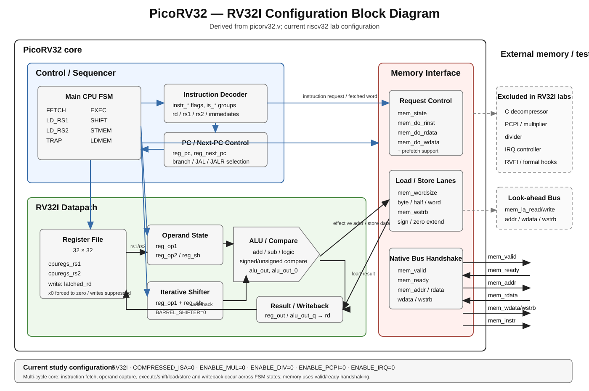

# PicoRV32 RTL Reading Notes

This is a relaxed side track for reading the upstream PicoRV32 RTL used by this repository.

The goal is **understanding**, not finishing a syllabus and not modifying the core. The main `riscv32` labs remain the structured path; this document is a source-reading notebook we can return to whenever CPU RTL is interesting.

The repository carries PicoRV32 from upstream commit `ef203c2b0a3fb793280f5114941416c425c5b461`. Keep `picorv32/picorv32.v` unmodified and record observations here.

The configured study core is **RV32I**: compressed instructions, multiply/divide and PCPI are disabled in the shared testbench.

## Study RTL projection

- [Line-preserving RV32I study RTL](rtl/picorv32-rv32i-study.v)
- [Projection rules and fixed configuration](rtl/README.md)

Use the study RTL for the relaxed source-order walkthrough, and cross-check any point against the untouched upstream copy under `picorv32/`.

## Block diagram



The diagram is derived from the RTL and shows the current RV32I study configuration. It is a living architectural view: as the source-order walkthrough exposes more precise boundaries or control relationships, update the SVG rather than treating it as an upstream specification.

## Goal: reconstruct an implementable RV32I core

Read `picorv32.v` **in RTL source order** and turn it into a compact implementation specification.

The intended end state is that these notes contain enough structure and behavior to write a small RV32I implementation without having to rediscover how the core fits together.

This is not a line-by-line translation of PicoRV32. For each RTL region, extract:

1. **Purpose** — what hardware responsibility this block owns.
2. **State** — registers/state variables that must survive a clock edge.
3. **Inputs and outputs** — signals entering/leaving the block.
4. **Combinational rules** — decisions that can be expressed without stored state.
5. **Sequential rules** — what changes on each relevant clock edge.
6. **Control transitions** — where the CPU/memory state machine goes next.
7. **Instruction coverage** — which RV32I instructions depend on this block.
8. **Implementation sketch** — short pseudocode or equations sufficient to rebuild the behavior.

We follow physical RTL order even when that is not the easiest pedagogical order. This lets the document become a companion map to the actual source.

Our implementation scope is the configuration used by the shared testbench:

```text
RV32I
COMPRESSED_ISA = 0
ENABLE_MUL     = 0
ENABLE_DIV     = 0
ENABLE_PCPI    = 0
ENABLE_IRQ     = 0
```

When the upstream RTL reaches C, M, PCPI, IRQ, trace, or formal-only machinery, record its boundary and skip the internal details unless they affect the RV32I path.

The RV32I instruction table below is therefore a **coverage index**, not the reading order. An instruction becomes `CHECKED` only when the source-ordered walkthrough has exposed its complete path from decode to architectural effect.

## RV32I instruction checklist

This table intentionally contains **only real RV32I instructions**.

Excluded:
- pseudoinstructions such as `nop`, `mv`, `li`, `ret`
- M-extension multiply/divide instructions
- C compressed instructions
- CSR instructions from the separate Zicsr extension
- `FENCE.I`, which belongs to the separate Zifencei extension

Status:
- `TODO` — not yet traced
- `CHECKED` — decode through architectural effect understood
- `NOTE` — behavior understood but deserves a follow-up detail

| # | Instruction | Class | Architectural effect | RTL status | RTL notes |
|---:|---|---|---|---|---|
| 1 | `LUI rd, imm` | U | `rd = imm << 12` | TODO | |
| 2 | `AUIPC rd, imm` | U | `rd = pc + (imm << 12)` | TODO | |
| 3 | `JAL rd, off` | J | `rd = pc+4; pc += off` | TODO | |
| 4 | `JALR rd, rs1, imm` | I | `rd = pc+4; pc = (rs1+imm) & ~1` | TODO | |
| 5 | `BEQ rs1, rs2, off` | B | branch if `rs1 == rs2` | TODO | |
| 6 | `BNE rs1, rs2, off` | B | branch if `rs1 != rs2` | TODO | |
| 7 | `BLT rs1, rs2, off` | B | signed `rs1 < rs2` | TODO | |
| 8 | `BGE rs1, rs2, off` | B | signed `rs1 >= rs2` | TODO | |
| 9 | `BLTU rs1, rs2, off` | B | unsigned `rs1 < rs2` | TODO | |
| 10 | `BGEU rs1, rs2, off` | B | unsigned `rs1 >= rs2` | TODO | |
| 11 | `LB rd, imm(rs1)` | I/load | load byte, sign-extend | TODO | |
| 12 | `LH rd, imm(rs1)` | I/load | load halfword, sign-extend | TODO | |
| 13 | `LW rd, imm(rs1)` | I/load | load word | TODO | |
| 14 | `LBU rd, imm(rs1)` | I/load | load byte, zero-extend | TODO | |
| 15 | `LHU rd, imm(rs1)` | I/load | load halfword, zero-extend | TODO | |
| 16 | `SB rs2, imm(rs1)` | S/store | store low byte | TODO | |
| 17 | `SH rs2, imm(rs1)` | S/store | store low halfword | TODO | |
| 18 | `SW rs2, imm(rs1)` | S/store | store word | TODO | |
| 19 | `ADDI rd, rs1, imm` | I/ALU | `rd = rs1 + imm` | TODO | |
| 20 | `SLTI rd, rs1, imm` | I/ALU | signed less-than immediate | TODO | |
| 21 | `SLTIU rd, rs1, imm` | I/ALU | unsigned less-than immediate | TODO | |
| 22 | `XORI rd, rs1, imm` | I/ALU | bitwise XOR immediate | TODO | |
| 23 | `ORI rd, rs1, imm` | I/ALU | bitwise OR immediate | TODO | |
| 24 | `ANDI rd, rs1, imm` | I/ALU | bitwise AND immediate | TODO | |
| 25 | `SLLI rd, rs1, shamt` | I/shift | logical left shift | TODO | |
| 26 | `SRLI rd, rs1, shamt` | I/shift | logical right shift | TODO | |
| 27 | `SRAI rd, rs1, shamt` | I/shift | arithmetic right shift | TODO | |
| 28 | `ADD rd, rs1, rs2` | R | `rd = rs1 + rs2` | TODO | |
| 29 | `SUB rd, rs1, rs2` | R | `rd = rs1 - rs2` | TODO | |
| 30 | `SLL rd, rs1, rs2` | R | logical left shift | TODO | |
| 31 | `SLT rd, rs1, rs2` | R | signed less-than | TODO | |
| 32 | `SLTU rd, rs1, rs2` | R | unsigned less-than | TODO | |
| 33 | `XOR rd, rs1, rs2` | R | bitwise XOR | TODO | |
| 34 | `SRL rd, rs1, rs2` | R | logical right shift | TODO | |
| 35 | `SRA rd, rs1, rs2` | R | arithmetic right shift | TODO | |
| 36 | `OR rd, rs1, rs2` | R | bitwise OR | TODO | |
| 37 | `AND rd, rs1, rs2` | R | bitwise AND | TODO | |
| 38 | `FENCE` | memory ordering | order memory/device accesses | TODO | |
| 39 | `ECALL` | SYSTEM | environment call | TODO | |
| 40 | `EBREAK` | SYSTEM | breakpoint request | TODO | |

## RTL-order walkthrough

We will grow this section as we move downward through `picorv32.v`. The order below follows the upstream source rather than grouping topics by ISA instruction.

### 0. File setup and core boundary — TODO

Document:

- preprocessor/debug/formal macros relevant to understanding the source
- `picorv32` module parameters
- top-level memory interface
- look-ahead memory interface
- optional PCPI/IRQ/RVFI/trace interfaces
- which parameters are fixed for our RV32I implementation

Implementation result: define the external contract of our future core before implementing any internals.

### 1. Core state and register file — TODO

Document:

- cycle/instruction counters
- `reg_pc`, `reg_next_pc`
- `reg_op1`, `reg_op2`, `reg_out`, `reg_sh`
- integer register file `cpuregs`
- x0 handling
- state needed only by excluded optional features

Implementation result: define the persistent datapath state.

### 2. Optional PCPI multiply/divide plumbing — OUT OF SCOPE

The upstream source encounters this before the memory interface. Record where it connects to the base core, but our RV32I implementation does not need the internal multiplier/divider/PCPI machinery.

### 3. Memory interface — TODO

This is the first substantial base-RV32I subsystem in source order.

Document:

- `mem_state`
- `mem_do_prefetch`, `mem_do_rinst`, `mem_do_rdata`, `mem_do_wdata`
- `mem_valid/mem_ready` transaction lifecycle
- instruction versus data transactions
- `mem_wordsize`
- byte/halfword/word lane selection
- load-data extraction
- store-data replication and write strobes
- look-ahead interface versus committed memory request
- which compressed-instruction paths disappear when `COMPRESSED_ISA=0`

Implementation result: enough detail to build the CPU's fetch/load/store bus controller independently.

### 4. Instruction decoder — TODO

Document in the exact order the RTL introduces and computes decode state:

- individual `instr_*` flags
- grouped `is_*` flags
- `decoded_rd`, `decoded_rs1`, `decoded_rs2`
- immediate generation
- decode trigger/latching behavior
- illegal-instruction detection
- instruction families sharing datapath/control logic

Implementation result: a decoder specification that maps a 32-bit RV32I instruction to operands, immediate, destination and control class.

### 5. Debug/decode bookkeeping — TODO / mostly nonessential

Separate implementation-essential decode state from source-only debug/trace helpers. Our own core should not inherit machinery merely because it appears in the reference source.

### 6. Datapath helpers, register access and ALU — TODO

Document:

- register-file read addresses/data
- writeback enable/address/data
- x0 suppression
- ALU input selection
- ADD/SUB/logic/compare operations
- signed versus unsigned compare
- barrel versus iterative shift behavior, retaining only the configuration we choose

Implementation result: reconstruct the integer datapath independently of the main control FSM.

### 7. Main CPU control state machine — TODO

Document each state in source order, including at least:

```text
FETCH
LD_RS1
LD_RS2
EXEC
SHIFT
STMEM
LDMEM
TRAP
```

For every state record:

- entry condition
- state-owned actions
- memory request started/completed
- register values latched
- next state
- architectural effect, if any

Implementation result: this becomes the central control specification for our own multi-cycle RV32I core.

### 8. Misalignment, trap and excluded optional tail logic — TODO

Document only the parts needed for the selected RV32I behavior:

- misaligned instruction/data detection
- illegal instruction behavior
- `ECALL` / `EBREAK`
- base trap behavior

Mark IRQ, RVFI and formal-verification machinery as reference/support logic rather than required datapath/control logic.

## Source map

A useful conceptual map of `picorv32.v`:

1. **Configuration and top-level interface**
   - feature parameters
   - native memory interface
   - look-ahead memory interface
   - PCPI coprocessor interface
   - optional IRQ, trace and RVFI interfaces

2. **Architectural and internal state**
   - `reg_pc`, `reg_next_pc`
   - operand/result registers such as `reg_op1`, `reg_op2`, `reg_out`
   - cycle/instruction counters
   - register file `cpuregs`

3. **Instruction fetch and memory sequencing**
   - instruction reads versus data reads/writes
   - `mem_valid` / `mem_ready` handshake
   - address/data/write-strobe generation
   - look-ahead signals

4. **Decode**
   - instruction fields and immediate construction
   - instruction-class decode
   - illegal-instruction handling

5. **Execution control**
   - CPU state machine
   - operand selection
   - ALU operations
   - branches and jumps
   - shifts and multi-cycle options

6. **Register-file read/write path**
   - source register selection
   - single-port versus dual-port configuration
   - writeback
   - x0 behavior

7. **Loads and stores**
   - byte/halfword/word access
   - sign/zero extension
   - write strobes
   - alignment checks

8. **Other base behavior**
   - `FENCE`
   - `ECALL` / `EBREAK`
   - counters and trap behavior where relevant

## Per-instruction note format

When a row is checked, add a short note below the table if useful:

```text
Instruction
ADD

Decode
Which decode signal/condition identifies it?

Operands
Where do rs1 and rs2 come from?

Execute
Which ALU/control expression performs the operation?

Architectural effect
Where/how is rd written or the PC/memory state changed?

PicoRV32 detail
Anything implementation-specific worth remembering?
```

The notebook should grow from actual RTL questions rather than attempting to document every line of PicoRV32.
