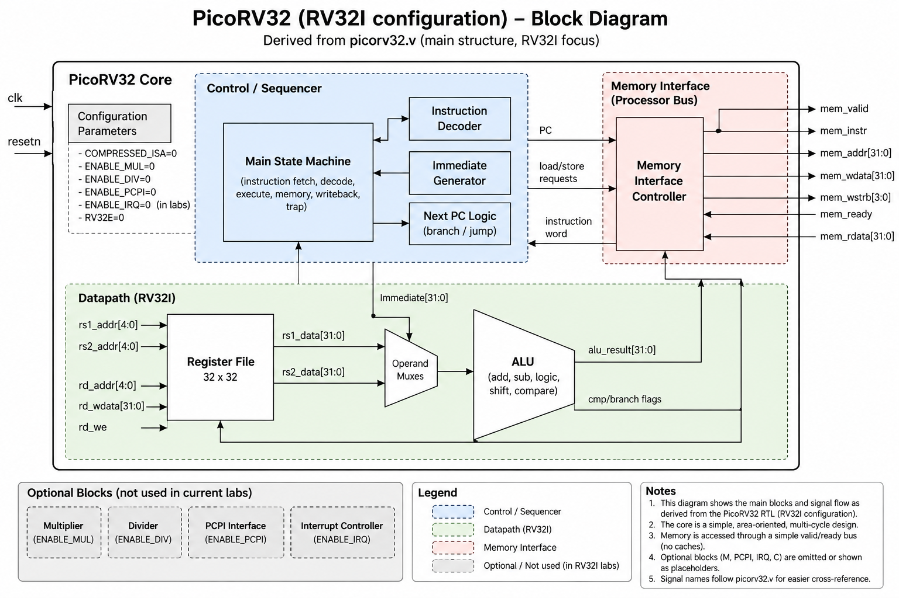

# PicoRV32 RTL Reading Notes

This is a relaxed side track for reading the upstream PicoRV32 RTL used by this repository.

The goal is **understanding**, not finishing a syllabus and not modifying the core. The main `riscv32` labs remain the structured path; this document is a source-reading notebook we can return to whenever CPU RTL is interesting.

The repository carries PicoRV32 from upstream commit `ef203c2b0a3fb793280f5114941416c425c5b461`. Keep `picorv32/picorv32.v` unmodified and record observations here.

The configured study core is **RV32I**: compressed instructions, multiply/divide and PCPI are disabled in the shared testbench.

## Study RTL views

- [Clean fixed-RV32I PicoRV32](rtl/picorv32-rv32i-clean.v) — **primary walkthrough file from S04 onward**
- [Line-preserving RV32I study RTL](rtl/picorv32-rv32i-study.v) — audit/reference snapshot
- [RTL view/validation notes](rtl/README.md)
- Independent RV32I seed core moved to separate repository: `wcheng95/mini5` (`rtl/rv32_core.v`)

The line-preserving view was useful for S01–S03 because source line numbers matched upstream exactly. Starting with the memory-interface study, use the cleaned fixed-RV32I core so disabled C/M/PCPI/IRQ/counter/trace paths no longer consume attention.

Phase A was validated cycle-for-cycle against fixed-configuration upstream PicoRV32 on Labs 00–06, including inserted memory wait states. Phase B is intentionally simpler and was validated architecturally through the strict-RV32I regression; it is not expected to preserve PicoRV32 timing.

## Session progress

### S01 — module parameters — DONE

**Study RTL:** through line 88  
**Next:** line 89, module port list

What we settled:

- PicoRV32 configuration values here are Verilog **parameters**: elaboration/build-time constants, not runtime pins.
- `INSN` means *instruction*; `CATCH_ILLINSN=1` catches unsupported/illegal instruction encodings and routes them toward trap handling.
- For the stripped study RTL, `ENABLE_COUNTERS=0`; cycle/instret counters are outside the strict RV32I study scope.
- With `ENABLE_IRQ=0`, `MASKED_IRQ`, `LATCHED_IRQ`, and `PROGADDR_IRQ` are IRQ-related configuration and not part of our RV32I path.
- `PROGADDR_RESET` supplies the reset PC.
- `STACKADDR` optionally supplies the initial value of `x2` / `sp`. The default `32'hffff_ffff` is a sentinel meaning PicoRV32 does not initialize `sp` from this parameter.
- RISC-V has no special stack engine: `sp` is architectural register `x2`, used by software convention with ordinary integer arithmetic and loads/stores.
- The standard stack grows toward lower addresses. A function allocates a frame by subtracting from `sp` and releases it by restoring `sp`.
- Standard RISC-V ABI stack alignment is 16 bytes, so a compliant `sp` has `sp[3:0] == 4'b0000`. Alignment alone does not make an address usable; the stack must also have valid writable memory below it.
- `STACKADDR` is mainly startup convenience: when supplied, hardware can initialize `sp` so startup software does not need to do so. The compiler generally only assumes that `sp` is valid when compiled code begins.

### S02 — module ports and local parameters — DONE

**Study RTL:** lines 89–173  
**Next:** line 174

What we settled:

- The minimal RV32I implementation interface keeps `clk`, `resetn`, `trap`, and the normal memory bus signals: `mem_valid`, `mem_instr`, `mem_ready`, `mem_addr`, `mem_wdata`, `mem_wstrb`, and `mem_rdata`.
- The look-ahead memory interface `mem_la_*` is a PicoRV32 optimization/interface convenience and is not required for the minimal implementation.
- PCPI, IRQ/EOI, and trace ports are outside our stripped RV32I implementation scope.
- `trap` is the core's terminal/fault indication in our minimal design.
- Among the local parameters in this section, the two that matter to our implementation are:
  - `regfile_size = 32`
  - `regindex_bits = 5`
- The remaining IRQ/trace/PCPI local parameters can be ignored for our RV32I reconstruction.

### S03 — core datapath state and PCPI boundary — DONE

**Study RTL:** lines 174–348  
**Next:** line 349, memory interface

What we settled:

- For this study, skip `dbg_*`, `pcpi_*`, and `irq_*` signals unless one directly affects the RV32I path.
- Core datapath/state signals introduced here:
  - `reg_pc` — current instruction PC.
  - `reg_next_pc` — next instruction address carried across cycles.
  - `reg_op1` — latched first operand, usually `rs1`.
  - `reg_op2` — latched second operand, either `rs2` or an immediate depending on the instruction.
  - `reg_out` — general result/temporary register used across FSM states.
  - `reg_sh` — shift count/state for the iterative shifter.
  - `next_insn_opcode` — fetched instruction word headed toward decode.
  - `next_pc` — combinational next-fetch address, defined later from control state.
  - `cpuregs` — built-in integer register file; in our configuration this is 32 × 32-bit.
- `count_cycle` and `count_instr` remain in the source but are inactive in the study configuration because `ENABLE_COUNTERS=0`.
- The `integer i` and `initial` register-file initialization block are irrelevant with `REGS_INIT_ZERO=0`.
- `empty_statement` is only a helper for the disabled/non-formal assert macro and is not CPU functionality.
- Lines 255–348 are internal PCPI plumbing. With PCPI/M/DIV disabled, this entire region is outside the RV32I implementation path and can be skipped.

### S04 — memory interface — DONE

**Clean study RTL:** lines 46–159  
**Next:** S05, instruction decoder, beginning at line 161

What we settled:

- The CPU FSM requests memory work internally with:
  - `mem_do_prefetch`
  - `mem_do_rinst`
  - `mem_do_rdata`
  - `mem_do_wdata`
- The external native bus uses the independent `mem_valid/mem_ready` handshake. A completed external transfer is:
  - `mem_xfer = mem_valid && mem_ready`
- `mem_done` is a CPU/memory-controller completion indication and is not identical in meaning to the raw external bus transfer because PicoRV32 also supports prefetch.
- `mem_instr=1` marks instruction traffic; data loads/stores use `mem_instr=0`.
- PicoRV32 presents a 32-bit word-aligned bus address. For data accesses:
  - `reg_op1[31:2]` selects the aligned 32-bit word.
  - `reg_op1[1:0]` selects the byte lane inside that word.
- `mem_wordsize` selects word/halfword/byte behavior. Stores replicate the low byte or halfword across the write-data bus and use `mem_wstrb` to select the active lane(s).
- Halfword lane selection needs only address bit `reg_op1[1]`; byte lane selection uses `reg_op1[1:0]`.
- Loads perform the inverse lane selection. The memory block extracts the byte/halfword and zero-extends it; signed `LB/LH` extension belongs to later CPU control/writeback logic.
- PicoRV32's look-ahead `mem_la_*` interface and instruction prefetch are microarchitectural performance mechanisms, transparent to the ISA/compiler. They are useful to understand as PicoRV32 behavior but are not required in a future from-scratch core.
- Memory FSM:
  - state 0 — idle / launch next read or write.
  - state 1 — read transaction waiting for `mem_xfer`.
  - state 2 — write transaction waiting for `mem_xfer`.
  - state 3 — completed prefetch held until the CPU requests the instruction with `mem_do_rinst`, then return to state 0.
- On terminal PicoRV32 `trap`, the memory FSM stops advancing; reset is what returns the core to normal execution.
- For a future simple core, a single blocking CPU FSM can own fetch/load/store directly; a separate memory FSM becomes useful only when independent memory progress such as prefetch/overlap is desired.
- The RV32I instruction checklist now includes binary encodings. Load/store instructions remain `TODO` until their full path from decode through architectural effect has been traced.

### S05 — instruction decoder — DONE

**Clean study RTL:** lines 161–355  
**Next:** S06, datapath/register access/ALU section

What we settled:

- PicoRV32 has 39 `instr_*` decoder flags representing the 40 base RV32I instructions because `ECALL` and `EBREAK` share one flag: `instr_ecall_ebreak`.
- Decoder outputs fall into three useful categories:
  - exact instruction flags such as `instr_add`, `instr_lw`, `instr_beq`
  - extracted operands/immediates such as `decoded_rd`, `decoded_rs1`, `decoded_rs2`, `decoded_imm`
  - grouped implementation/control classes such as `is_alu_reg_imm`, `is_sb_sh_sw`, `is_compare`
- The decoder is staged across clock edges rather than being one large combinational decoder.
- Stage 1 runs when an instruction read completes:
  - recognizes opcode-unique instructions such as `LUI`, `AUIPC`, `JAL`
  - recognizes opcode families such as loads, stores, OP-IMM and OP
  - extracts `rd`, `rs1`, `rs2`
  - constructs the J-type immediate
- Stage 2 runs under `decoder_trigger` and refines opcode families with `funct3` and `funct7` into exact instructions.
- Instructions whose opcode uniquely identifies them, especially `JAL`, are already fully identified in stage 1. The common stage-2 block still executes, but those instructions do not depend on a stage-2 result before the CPU control logic can act.
- RISC-V keeps `rd`, `rs1`, and `rs2` in fixed bit positions across the relevant instruction formats, which simplifies register-field extraction.
- Immediate reconstruction is format-specific:
  - I-type: sign-extend `insn[31:20]`
  - S-type: combine `insn[31:25]` and `insn[11:7]`
  - B-type: reorder the split branch immediate and append bit 0 = 0
  - U-type: `insn[31:12] << 12`
  - J-type: reorder JAL immediate bits and append bit 0 = 0
- For a future from-scratch Mini5 decoder, prefer explicit format signals such as `imm_i`, `imm_s`, `imm_b`, `imm_u`, and `imm_j` instead of overloading one general immediate signal.
- Prefer explicit sign extension such as `{{20{insn[31]}}, insn[31:20]}` for ISA field construction; reserve `$signed` mainly for operations whose semantics are genuinely signed, such as signed compares.
- `instr_trap` means no recognized legal instruction flag is active. `ECALL`/`EBREAK` intentionally remain outside the normal legal-instruction list because this stripped PicoRV32 configuration treats them as trap-generating operations.
- `FENCE` is decoded as a legal instruction but has no dedicated execution action in this core. With one outstanding blocking memory transaction and no cache/store buffer/reordering machinery, normal accesses are already serialized, so `FENCE` is effectively a legal NOP.
- `FENCE.I` is not part of base RV32I; it belongs to the separate Zifencei extension and remains outside the current scope.
- The `is_*` grouped signals exist to serve the chosen PicoRV32 datapath/FSM structure. A future Mini5 decoder may group instructions differently depending on its control architecture.

### S06 — datapath helpers, register access and ALU — DONE

**Clean study RTL:** lines 356–441  
**Next:** S07, main CPU control FSM, beginning at line 443

What we settled:

- CPU state declarations use one-hot-style encoding. The old single-port second-register-read state is absent in the cleaned dual-port configuration, leaving a hole in the encoding.
- `latched_store` is a misleading PicoRV32 name in the cleaned core. It behaves more like **writeback/result pending** than a memory-store indicator.
- `latched_stalu` selects the ALU result path for register writeback; otherwise writeback commonly comes from `reg_out`.
- `next_pc` normally follows `reg_next_pc`, but a taken branch/JALR path can select `reg_out & ~1`.
- The ALU shares one add/sub datapath:
  - `SUB` selects subtraction.
  - ADD/ADDI and address/PC-relative operations reuse addition.
- Comparisons are separated into:
  - equality
  - signed less-than
  - unsigned less-than
- Using `$signed` is appropriate for genuinely signed arithmetic/comparison semantics such as signed less-than, even though explicit concatenation is preferred for ISA-field sign extension.
- `alu_out_0` is the 1-bit compare/branch result.
- `alu_out` is the 32-bit architectural ALU result:
  - add/sub
  - compare converted to 0/1
  - XOR
  - OR
  - AND
- Shift instructions are not handled by this ALU block; they use the separate iterative `CPU_SHIFT` state.
- Register-file reads are combinational dual-port reads:
  - `decoded_rs1 == 0` forces read value 0
  - `decoded_rs2 == 0` forces read value 0
- Register-file writes suppress `rd == 0`, so x0 is protected on both read and write sides.
- Register writeback occurs while the CPU is back in `CPU_FETCH`, making FETCH both an instruction-boundary state and the previous instruction's writeback/commit point.
- `cpuregs_wrdata` means **CPU register-file writeback data**, not memory write data. Memory stores use `mem_wdata`.
- Typical `reg_out` writeback users include:
  - loads
  - iterative shifts
  - optional initial stack-pointer setup
- Typical `alu_out_q` writeback users are ordinary ALU instructions.
- `launch_next_insn = (cpu_state == CPU_FETCH && decoder_trigger)` means a decoded instruction is being accepted/launched at the instruction boundary; it does not mean the external memory bus is currently fetching. In the cleaned RTL this signal is unused and can be ignored.

### S07 — main CPU control state machine — DONE

**Clean study RTL:** lines 443–689  
**Status:** PicoRV32 RV32I walkthrough complete

What we settled:

- The main CPU FSM contains seven active states in the cleaned dual-port RV32I configuration:
  - `CPU_TRAP`
  - `CPU_FETCH`
  - `CPU_RS1`
  - `CPU_EXEC`
  - `CPU_SHIFT`
  - `CPU_STORE`
  - `CPU_LOAD`
- Normal ALU instructions typically follow `FETCH → RS1 → EXEC → FETCH`; the exact instruction latency is variable because JAL has a fast path, shifts are iterative, and memory operations wait for `mem_done`.
- `CPU_FETCH` is more than a fetch state: it is also the instruction-boundary/writeback point for the previous instruction, selects the current/next PC, launches a decoded instruction, and handles the JAL fast path.
- `reg_pc` is the PC of the current instruction; `reg_next_pc` carries the future fetch address. They can receive the same default value in FETCH and then diverge when the later nonblocking assignment updates `reg_next_pc` to `PC+4` or a jump target.
- PicoRV32 uses procedural priority heavily: later nonblocking assignments to the same register override earlier scheduled assignments in the same clocked block. This is legal but not the preferred Mini5 coding style.
- Mini5 style preference:
  - combinational next-value/data-path logic with `assign` or `always @*`
  - clocked architectural state with nonblocking `<=`
  - keep FSM code focused primarily on state progression
  - avoid implicit Boolean tests on buses when an explicit comparison is clearer
- `CPU_RS1` is effectively an operand-preparation/dispatch state. Every base-RV32I instruction except the JAL fast path enters it and is dispatched to TRAP, EXEC, SHIFT, STORE, or LOAD.
- The current PicoRV32 style repeats `CPU_EXEC` transitions in several instruction-family branches because operand preparation is kept local to each family. Mini5 may instead separate operand/control generation from next-state selection.
- `CPU_EXEC` is one cycle for ordinary ALU-style instructions. Branches may remain in EXEC while PicoRV32 settles or redirects the outstanding sequential instruction prefetch.
- `CPU_SHIFT` implements an iterative shifter. With `TWO_STAGE_SHIFT=1`, it shifts by four bits while at least four remain, otherwise by one bit. A 31-bit shift takes 10 shift clocks plus one final zero-detect/exit clock in `CPU_SHIFT`.
- `CPU_STORE` is dedicated to `SB`, `SH`, and `SW`.
- `CPU_LOAD` is dedicated to `LB`, `LH`, `LW`, `LBU`, and `LHU`; loaded data is placed in `reg_out`, then written to `rd` from the FETCH-state writeback path.
- Register-file writeback occurs at lines 437–439:
  - `cpuregs[latched_rd] <= cpuregs_wrdata`
  - writeback to x0 is suppressed by the `latched_rd` condition
- PicoRV32's `mem_do_prefetch <= !instr_jalr` does not accidentally include JAL: JAL is handled by the surrounding `if (instr_jal) ... else ...` structure and never executes that assignment.
- Trap sources in the cleaned core are:
  - illegal/unsupported instruction, including terminal handling of ECALL/EBREAK
  - misaligned data access
  - misaligned instruction fetch
  - invalid CPU FSM state as a defensive internal fallback
- All architectural trap causes collapse into terminal `CPU_TRAP` behavior in this stripped core; reset is required to resume execution.
- The tail logic clears completed memory-request flags, then may reassert a new request through `set_mem_do_rinst/rdata/wdata` on the same clock edge.
- A checkpoint quiz covering memory handshake, byte lanes, JAL fast path, iterative-shift timing, writeback, branch/prefetch behavior, decoder coverage, dispatch, and blocking/nonblocking semantics was completed **10/10**.

Implementation result: the cleaned PicoRV32 RV32I core is understood well enough to serve as a reference for a future from-scratch Mini5 implementation rather than as code that must be copied.

## Block diagram



The diagram is derived from the RTL and shows the current RV32I study configuration. It is a living architectural view: as the source-order walkthrough exposes more precise boundaries or control relationships, update the SVG rather than treating it as an upstream specification.

## Goal: reconstruct an implementable RV32I core

**Walkthrough status: COMPLETE.** The cleaned RV32I PicoRV32 has been traced from interface through memory, decode, datapath, writeback, CPU FSM, and traps. All 40 base-RV32I checklist entries are now marked `CHECKED`.

Read `picorv32.v` **in RTL source order** and turn it into a compact implementation specification.

The intended end state is that these notes contain enough structure and behavior to write a small RV32I implementation without having to rediscover how the core fits together.

This is not a line-by-line translation of PicoRV32. For each RTL region, extract:

1. **Purpose** — what hardware responsibility this block owns.
2. **State** — registers/state variables that must survive a clock edge.
3. **Inputs and outputs** — signals entering/leaving the block.
4. **Combinational rules** — decisions that can be expressed without stored state.
5. **Sequential rules** — what changes on each relevant clock edge.
6. **Control transitions** — where the CPU/memory state machine goes next.
7. **Instruction coverage** — which RV32I instructions depend on this block.
8. **Implementation sketch** — short pseudocode or equations sufficient to rebuild the behavior.

We follow physical RTL order even when that is not the easiest pedagogical order. This lets the document become a companion map to the actual source.

Our implementation scope is the configuration used by the shared testbench:

```text
RV32I
COMPRESSED_ISA = 0
ENABLE_MUL     = 0
ENABLE_DIV     = 0
ENABLE_PCPI    = 0
ENABLE_IRQ     = 0
```

When the upstream RTL reaches C, M, PCPI, IRQ, trace, or formal-only machinery, record its boundary and skip the internal details unless they affect the RV32I path.

The RV32I instruction table below is therefore a **coverage index**, not the reading order. An instruction becomes `CHECKED` only when the source-ordered walkthrough has exposed its complete path from decode to architectural effect.

## Next goal after PicoRV32: minimum FreeRTOS-capable MCU

Do **not** start this until the PicoRV32 RV32I core walkthrough is complete. The immediate goal remains understanding the existing core well enough to reconstruct it independently.

After that, use the reconstructed RV32I core as the base for a minimal standards-based RISC-V MCU capable of running FreeRTOS.

Target progression:

```text
understand PicoRV32 RV32I completely
        ↓
reconstruct own small RV32I core
        ↓
add Zicsr
        ↓
add minimal Machine-mode trap/interrupt support
        ↓
add timer interrupt
        ↓
run FreeRTOS
        ↓
add peripherals / accelerators incrementally
```

### Minimum architectural additions

Keep the first MCU intentionally small:

- **RV32I** base ISA.
- **Zicsr** CSR instructions.
- **Machine mode only**; no Supervisor/User mode requirement.
- Minimal Machine-mode CSRs needed by the FreeRTOS port:
  - `mstatus`
  - `mie`
  - `mip`
  - `mtvec`
  - `mepc`
  - `mcause`
  - `mscratch`
  - add `mtval` only when useful for cleaner exception reporting.
- **`MRET`** to return from traps/interrupts.
- **`ECALL`** handling for voluntary FreeRTOS task yield.
- One **periodic Machine-mode timer interrupt** for the FreeRTOS tick.
- Writable RAM for task stacks and the FreeRTOS heap.
- Program storage in ROM/flash/RAM.

Not required for the first FreeRTOS MCU:

- A extension / atomics for a single-core implementation.
- MMU.
- PMP.
- FPU.
- Vector extension.
- Multi-core support.
- Full CLINT if a simpler timer can provide the required Machine-mode tick interrupt.

### Minimal trap behavior

On interrupt or exception, the hardware should conceptually provide:

```text
mepc          ← interrupted/faulting PC
mcause        ← trap cause
mstatus.MPIE  ← mstatus.MIE
mstatus.MIE   ← 0
PC            ← mtvec
```

Software then saves/restores the remaining task context. `MRET` restores the Machine interrupt-enable state and resumes execution from `mepc`.

For an `ECALL`-based FreeRTOS yield, the trap handler must distinguish the environment-call cause, perform the scheduler/context-switch work, advance `mepc` past the `ECALL`, and return with `MRET`.

### Minimal timer

Start with a deliberately small timer block:

```text
free-running counter
        │
   compare register
        │
counter >= compare
        ↓
Machine timer interrupt
        ↓
FreeRTOS tick handler
```

A standards-compatible `mtime` / `mtimecmp` style interface is desirable, but the first implementation may use a simpler memory-mapped timer if the small FreeRTOS port layer is adapted cleanly.

### First FreeRTOS milestone

Keep the first software test smaller than MiniShell or any real application:

```text
Task A increments / reports A
Task B increments / reports B
periodic timer tick preempts them
explicit yield via ECALL works
context resumes correctly
```

Only after that baseline is stable should the MCU grow UART, GPIO, MiniShell, or accelerators.

### Development platform and project boundary

Do not build the software toolchain or a complete machine ecosystem from scratch.

Use existing, standard components:

```text
RISC-V GCC / binutils
        ↓
FreeRTOS + firmware
        ↓
QEMU RISC-V virt machine
        ↓
reference behavior / software bring-up
        ↓
our RV32I + Zicsr + M-mode RTL
        ↓
minimal compatible MCU peripherals
        ↓
FPGA
```

The compiler, assembler, linker, debugger and ABI are **not** part of this project. The CPU should run ordinary compiler-generated RISC-V code rather than requiring a custom compiler.

Use QEMU `virt` as the software/reference platform so we do not need to invent every board-level convention ourselves. Prove FreeRTOS and firmware behavior there first, then reproduce only the software-visible hardware that the RTL MCU actually needs.

Do **not** try to clone the complete QEMU `virt` machine in FPGA. Start with the minimum useful hardware:

```text
RV32I + Zicsr + M-mode CPU
            │
            ├── RAM
            ├── timer / software-interrupt block
            └── UART
```

Add PLIC, flash interfaces, GPIO or other peripherals only when a concrete requirement appears.

A useful validation target is to keep the same normal RISC-V software/toolchain path across:

```text
QEMU
  ↓
RTL simulation
  ↓
FPGA
```

The closer the firmware environment stays across those three targets, the less custom infrastructure we need to maintain. Future own-core work now belongs in the separate `mini5` repository.

### FPGA target

The MCU RTL is intended to run on FPGA after the software path has been validated in QEMU and RTL simulation.

The FPGA is the hardware learning/deployment target, not a reason to build a custom compiler, operating system, or board ecosystem. Keep hardware/software boundaries conventional wherever possible so effort stays concentrated on CPU architecture, interrupt/trap support, peripherals and accelerators.

### Accelerator direction

Future accelerators such as an LDPC decoder should initially sit behind a clean module/interface boundary rather than being mixed directly into the CPU datapath.

A first version can be memory-mapped:

```text
CPU
 │
 │ registers / command / data
 ▼
LDPC accelerator
 │
 └── status / result / interrupt
```

Custom instructions can be considered later only if measurements show that the memory-mapped command path is a meaningful bottleneck.

The design principle for this evolution remains: keep the RV32I core understandable and stable, and add capability around it in owned, decoupled modules.

## RV32I instruction checklist

This table intentionally contains **only real RV32I instructions**.

Excluded:
- pseudoinstructions such as `nop`, `mv`, `li`, `ret`
- M-extension multiply/divide instructions
- C compressed instructions
- CSR instructions from the separate Zicsr extension
- `FENCE.I`, which belongs to the separate Zifencei extension

Encoding notation:
- `rd`, `rs1`, `rs2` are 5-bit register fields
- `imm[...]` shows immediate-bit placement in the 32-bit instruction
- spaces separate architectural instruction fields
- fixed binary fields are written literally

Status:
- `TODO` — not yet traced
- `CHECKED` — decode through architectural effect understood
- `NOTE` — behavior understood but deserves a follow-up detail

| # | Instruction | Class | Binary encoding (31 → 0) | Architectural effect | RTL status | RTL notes |
|---:|---|---|---|---|---|---|
| 1 | `LUI rd, imm` | U | `imm[31:12] rd 0110111` | `rd = imm << 12` | CHECKED | |
| 2 | `AUIPC rd, imm` | U | `imm[31:12] rd 0010111` | `rd = pc + (imm << 12)` | CHECKED | |
| 3 | `JAL rd, off` | J | `imm[20] imm[10:1] imm[11] imm[19:12] rd 1101111` | `rd = pc+4; pc += off` | CHECKED | |
| 4 | `JALR rd, rs1, imm` | I | `imm[11:0] rs1 000 rd 1100111` | `rd = pc+4; pc = (rs1+imm) & ~1` | CHECKED | |
| 5 | `BEQ rs1, rs2, off` | B | `imm[12] imm[10:5] rs2 rs1 000 imm[4:1] imm[11] 1100011` | branch if `rs1 == rs2` | CHECKED | |
| 6 | `BNE rs1, rs2, off` | B | `imm[12] imm[10:5] rs2 rs1 001 imm[4:1] imm[11] 1100011` | branch if `rs1 != rs2` | CHECKED | |
| 7 | `BLT rs1, rs2, off` | B | `imm[12] imm[10:5] rs2 rs1 100 imm[4:1] imm[11] 1100011` | signed `rs1 < rs2` | CHECKED | |
| 8 | `BGE rs1, rs2, off` | B | `imm[12] imm[10:5] rs2 rs1 101 imm[4:1] imm[11] 1100011` | signed `rs1 >= rs2` | CHECKED | |
| 9 | `BLTU rs1, rs2, off` | B | `imm[12] imm[10:5] rs2 rs1 110 imm[4:1] imm[11] 1100011` | unsigned `rs1 < rs2` | CHECKED | |
| 10 | `BGEU rs1, rs2, off` | B | `imm[12] imm[10:5] rs2 rs1 111 imm[4:1] imm[11] 1100011` | unsigned `rs1 >= rs2` | CHECKED | |
| 11 | `LB rd, imm(rs1)` | I/load | `imm[11:0] rs1 000 rd 0000011` | load byte, sign-extend | CHECKED | |
| 12 | `LH rd, imm(rs1)` | I/load | `imm[11:0] rs1 001 rd 0000011` | load halfword, sign-extend | CHECKED | |
| 13 | `LW rd, imm(rs1)` | I/load | `imm[11:0] rs1 010 rd 0000011` | load word | CHECKED | |
| 14 | `LBU rd, imm(rs1)` | I/load | `imm[11:0] rs1 100 rd 0000011` | load byte, zero-extend | CHECKED | |
| 15 | `LHU rd, imm(rs1)` | I/load | `imm[11:0] rs1 101 rd 0000011` | load halfword, zero-extend | CHECKED | |
| 16 | `SB rs2, imm(rs1)` | S/store | `imm[11:5] rs2 rs1 000 imm[4:0] 0100011` | store low byte | CHECKED | |
| 17 | `SH rs2, imm(rs1)` | S/store | `imm[11:5] rs2 rs1 001 imm[4:0] 0100011` | store low halfword | CHECKED | |
| 18 | `SW rs2, imm(rs1)` | S/store | `imm[11:5] rs2 rs1 010 imm[4:0] 0100011` | store word | CHECKED | |
| 19 | `ADDI rd, rs1, imm` | I/ALU | `imm[11:0] rs1 000 rd 0010011` | `rd = rs1 + imm` | CHECKED | |
| 20 | `SLTI rd, rs1, imm` | I/ALU | `imm[11:0] rs1 010 rd 0010011` | signed less-than immediate | CHECKED | |
| 21 | `SLTIU rd, rs1, imm` | I/ALU | `imm[11:0] rs1 011 rd 0010011` | unsigned less-than immediate | CHECKED | |
| 22 | `XORI rd, rs1, imm` | I/ALU | `imm[11:0] rs1 100 rd 0010011` | bitwise XOR immediate | CHECKED | |
| 23 | `ORI rd, rs1, imm` | I/ALU | `imm[11:0] rs1 110 rd 0010011` | bitwise OR immediate | CHECKED | |
| 24 | `ANDI rd, rs1, imm` | I/ALU | `imm[11:0] rs1 111 rd 0010011` | bitwise AND immediate | CHECKED | |
| 25 | `SLLI rd, rs1, shamt` | I/shift | `0000000 shamt rs1 001 rd 0010011` | logical left shift | CHECKED | |
| 26 | `SRLI rd, rs1, shamt` | I/shift | `0000000 shamt rs1 101 rd 0010011` | logical right shift | CHECKED | |
| 27 | `SRAI rd, rs1, shamt` | I/shift | `0100000 shamt rs1 101 rd 0010011` | arithmetic right shift | CHECKED | |
| 28 | `ADD rd, rs1, rs2` | R | `0000000 rs2 rs1 000 rd 0110011` | `rd = rs1 + rs2` | CHECKED | |
| 29 | `SUB rd, rs1, rs2` | R | `0100000 rs2 rs1 000 rd 0110011` | `rd = rs1 - rs2` | CHECKED | |
| 30 | `SLL rd, rs1, rs2` | R | `0000000 rs2 rs1 001 rd 0110011` | logical left shift | CHECKED | |
| 31 | `SLT rd, rs1, rs2` | R | `0000000 rs2 rs1 010 rd 0110011` | signed less-than | CHECKED | |
| 32 | `SLTU rd, rs1, rs2` | R | `0000000 rs2 rs1 011 rd 0110011` | unsigned less-than | CHECKED | |
| 33 | `XOR rd, rs1, rs2` | R | `0000000 rs2 rs1 100 rd 0110011` | bitwise XOR | CHECKED | |
| 34 | `SRL rd, rs1, rs2` | R | `0000000 rs2 rs1 101 rd 0110011` | logical right shift | CHECKED | |
| 35 | `SRA rd, rs1, rs2` | R | `0100000 rs2 rs1 101 rd 0110011` | arithmetic right shift | CHECKED | |
| 36 | `OR rd, rs1, rs2` | R | `0000000 rs2 rs1 110 rd 0110011` | bitwise OR | CHECKED | |
| 37 | `AND rd, rs1, rs2` | R | `0000000 rs2 rs1 111 rd 0110011` | bitwise AND | CHECKED | |
| 38 | `FENCE` | memory ordering | `fm pred succ 00000 000 00000 0001111` | order memory/device accesses | CHECKED | |
| 39 | `ECALL` | SYSTEM | `000000000000 00000 000 00000 1110011` | environment call | CHECKED | |
| 40 | `EBREAK` | SYSTEM | `000000000001 00000 000 00000 1110011` | breakpoint request | CHECKED | |

## RTL-order walkthrough

We will grow this section as we move downward through `picorv32.v`. The order below follows the upstream source rather than grouping topics by ISA instruction.

### 0. File setup and core boundary — DONE

S01 covered the module parameters through line 88. S02 covered the module port list and local parameters through line 173.

Document:

- preprocessor/debug/formal macros relevant to understanding the source
- `picorv32` module parameters
- top-level memory interface
- look-ahead memory interface
- optional PCPI/IRQ/RVFI/trace interfaces
- which parameters are fixed for our RV32I implementation

Implementation result: define the external contract of our future core before implementing any internals.

### 1. Core state and register file — DONE

S03 covered study RTL lines 174–348. Lines 255–348 are PCPI-only and skipped.

Document:

- cycle/instruction counters
- `reg_pc`, `reg_next_pc`
- `reg_op1`, `reg_op2`, `reg_out`, `reg_sh`
- integer register file `cpuregs`
- x0 handling
- state needed only by excluded optional features

Implementation result: define the persistent datapath state.

### 2. Optional PCPI multiply/divide plumbing — SKIPPED (S03)

The upstream source encounters this before the memory interface. Record where it connects to the base core, but our RV32I implementation does not need the internal multiplier/divider/PCPI machinery.

### 3. Memory interface — DONE (S04)

S04 uses the cleaned fixed-RV32I file, lines 46–159.

Documented:

- internal CPU memory requests versus the external `mem_valid/mem_ready` bus handshake
- `mem_xfer` versus `mem_done`
- instruction versus data transactions
- `mem_wordsize`
- aligned 32-bit bus addressing and low-address-bit byte-lane selection
- byte/halfword/word load extraction
- store-data replication and write strobes
- PicoRV32 look-ahead and prefetch behavior
- the four memory states: idle, read wait, write wait, and prefetched-instruction hold
- terminal-trap behavior at the memory-controller boundary
- which mechanisms are PicoRV32 performance choices rather than requirements for a future simple core

Implementation result: enough detail to independently build a blocking fetch/load/store interface, while recognizing where PicoRV32 adds prefetch overlap.

### 4. Instruction decoder — DONE (S05)

S05 uses the cleaned fixed-RV32I file, lines 161–355.

Documented:

- exact `instr_*` flags versus grouped `is_*` control classes
- 39 decoder flags representing 40 RV32I instructions because ECALL/EBREAK share a flag
- staged opcode-family and funct3/funct7 decode
- fixed register-field positions
- I/S/B/U/J immediate reconstruction
- illegal-instruction detection
- opcode-unique instructions that logically complete decode in stage 1
- `FENCE` as a legal NOP in this simple serialized memory architecture
- `FENCE.I` exclusion from base RV32I
- decoder-style preferences for a future from-scratch Mini5 implementation

Implementation result: enough detail to build an independent RV32I decoder with explicit format immediates and control classes chosen for our own datapath rather than copied mechanically from PicoRV32.

### 5. Debug/decode bookkeeping — SKIPPED / nonessential in cleaned RTL

Separate implementation-essential decode state from source-only debug/trace helpers. Our own core should not inherit machinery merely because it appears in the reference source.

### 6. Datapath helpers, register access and ALU — DONE (S06)

S06 uses the cleaned fixed-RV32I file, lines 356–441.

Documented:

- CPU state/control declarations relevant to datapath use
- ALU add/sub/logic/compare behavior
- signed versus unsigned comparisons
- compare-to-0/1 result generation
- dual-port register-file reads
- x0 read/write suppression
- writeback source selection
- `reg_out` versus `alu_out_q`
- PicoRV32 naming/style observations relevant to a future Mini5 implementation
- `launch_next_insn` as an unused cleaned-core helper

Implementation result: enough detail to reconstruct the integer datapath and register writeback path independently, while deferring the exact sequencing to the CPU FSM.

### 7. Main CPU control state machine — DONE (S07)

S07 uses the cleaned fixed-RV32I file, lines 443–689.

Documented:

- reset/default actions
- FETCH as instruction boundary, PC selection, writeback point, and JAL fast path
- RS1 as operand preparation / dispatch
- EXEC behavior for ALU, JALR, and branches
- iterative SHIFT timing
- dedicated STORE and LOAD states
- branch/prefetch interaction
- memory-request clear/reassert priority
- coding-style observations relevant to Mini5

Implementation result: the complete control flow of the cleaned multi-cycle RV32I core can now be reconstructed independently.

### 8. Misalignment, trap and excluded optional tail logic — DONE (S07)

Documented:

- misaligned word/halfword data access checks
- 4-byte instruction alignment with compressed ISA disabled
- illegal instruction and ECALL/EBREAK terminal trap behavior
- invalid-state defensive trap
- reset as the only recovery path from terminal `CPU_TRAP`

The PicoRV32 RV32I source-order walkthrough is complete.

## Source map

A useful conceptual map of `picorv32.v`:

1. **Configuration and top-level interface**
   - feature parameters
   - native memory interface
   - look-ahead memory interface
   - PCPI coprocessor interface
   - optional IRQ, trace and RVFI interfaces

2. **Architectural and internal state**
   - `reg_pc`, `reg_next_pc`
   - operand/result registers such as `reg_op1`, `reg_op2`, `reg_out`
   - cycle/instruction counters
   - register file `cpuregs`

3. **Instruction fetch and memory sequencing**
   - instruction reads versus data reads/writes
   - `mem_valid` / `mem_ready` handshake
   - address/data/write-strobe generation
   - look-ahead signals

4. **Decode**
   - instruction fields and immediate construction
   - instruction-class decode
   - illegal-instruction handling

5. **Execution control**
   - CPU state machine
   - operand selection
   - ALU operations
   - branches and jumps
   - shifts and multi-cycle options

6. **Register-file read/write path**
   - source register selection
   - single-port versus dual-port configuration
   - writeback
   - x0 behavior

7. **Loads and stores**
   - byte/halfword/word access
   - sign/zero extension
   - write strobes
   - alignment checks

8. **Other base behavior**
   - `FENCE`
   - `ECALL` / `EBREAK`
   - counters and trap behavior where relevant

## Per-instruction note format

When a row is checked, add a short note below the table if useful:

```text
Instruction
ADD

Decode
Which decode signal/condition identifies it?

Operands
Where do rs1 and rs2 come from?

Execute
Which ALU/control expression performs the operation?

Architectural effect
Where/how is rd written or the PC/memory state changed?

PicoRV32 detail
Anything implementation-specific worth remembering?
```

The notebook should grow from actual RTL questions rather than attempting to document every line of PicoRV32.
